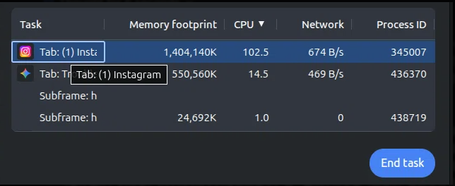
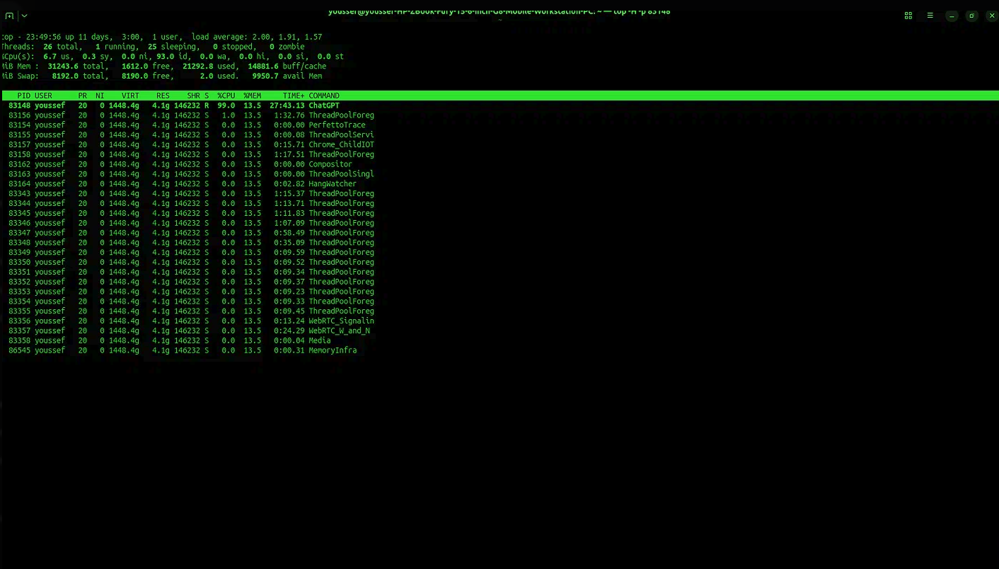
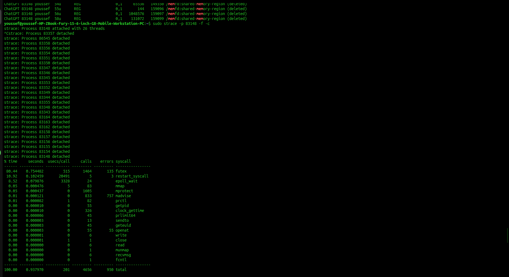

# Incident Response Writeup: Recurring Chromium & Electron Renderer CPU Exhaustion

## Executive Summary
An investigation was initiated following excessive thermal throttling and loud fan noise on my laptop. Analysis revealed a recurring architectural issue where a single renderer process consumed ~100% of a CPU core. The first incident involved a Google Chrome tab (PID 345007, 1.4GB RAM) rendering Instagram, which utilizes the Chromium engine. The second incident involved the ChatGPT Desktop App (PID 83148, 4.2GB RAM), an Electron application which packages the Chromium engine.

Through systematic triage using native Linux tools, the root cause was traced to a userspace busy-wait loop (futex spinlock) and aggressive network polling (epoll_wait). The issue was resolved surgically via process termination without rebooting the OS or crashing the parent application.

## Background and Recurrence
This issue was faced previously on this machine. Leaving heavy web applications or Electron-based desktop apps running for extended periods (days) consistently triggers this behavior. Interestingly, in the second incident, the ChatGPT application window was not actively open or visible on the desktop. This indicates that the Electron application failed to properly clean up its renderer process upon window closure, leaving a "ghost" process trapped in a background busy-loop.

---

## Command Summary
A quick reference of the commands utilized and their effects during the investigation:

*   `top` -> Displayed real-time system resource usage; revealed the target process consuming ~100% CPU.
*   `ps -p <PID> -o cmd=` -> (Process Status) Identified the exact command line that launched the specific Process ID.
*   `sudo lsof -p <PID>` -> (List Open Files) Showed every file, memory region (`memfd`), and network socket held open by the process.
*   `sudo strace -p <PID> -f -c` -> (System Trace) Intercepted and summarized the system calls the process made to the Linux Kernel.
*   `top -H -p <PID>` -> Filtered `top` to show only the specific process, broken down by individual threads (the `-H` flag shows threads).
*   `kill <PID>` -> Sent a termination signal to the specific process.

---

## Investigation Sequence

### Case Study 1: Instagram Web Tab (PID 345007)
**1. Symptom Identification & Thread Analysis:** Execution of `top -H -p 345007` revealed the main process consuming 99.3% CPU, while its 40 worker threads were mostly sleeping at 0.0% CPU. This localized the issue to the main renderer thread.
*Reference: [Visual 1 - Instagram Thread Distribution]*
**2. Process Context:** `ps -p 345007 -o cmd=` identified it as `/opt/google/chrome/chrome --type=renderer`.
**3. Memory Inspection:** `sudo lsof -p 345007` showed a 1.4GB memory footprint, signaling a probable memory leak acquired over a multi-day session.
**4. System Call Tracing:** `sudo strace -p 345007 -f -c` revealed the process spent 85% of its time in `futex` and 12% in `epoll_wait`. 
*Reference: [Visual 2 - Instagram Strace Summary]*

### Case Study 2: ChatGPT Desktop App (PID 83148)
**1. Symptom Identification & Thread Analysis:** A recurrence of the loud fan noise led to execution of `top -H -p 83148`, revealing the main thread consuming 99.0% CPU while its 25 worker threads were sleeping.
*Reference: [Visual 4 - ChatGPT Thread Distribution]*
**2. Process Context:** `ps -p 83148 -o cmd=` identified it as `/usr/lib/chatgpt/ChatGPT --type=renderer`. This confirmed the desktop app is an Electron wrapper utilizing the Chromium engine.
**3. Memory Inspection:** `sudo lsof -p 83148` and `top` revealed a massive 4.2GB memory footprint, heavily loaded with `memfd:shared-memory-region` files, indicating a severe memory leak.
**4. System Call Tracing:** `sudo strace -p 83148 -f -c` revealed the process spent 80.44% of its time in `futex` and 8.52% in `epoll_wait`.
*Reference: [Visual 5 - ChatGPT Strace Summary]*

---

## Root cause analysis and concepts understood

### Chromium and Electron Architecture
Google Chrome and Electron apps (like ChatGPT) utilize a multi-process architecture. The main "Browser Process" manages the window, while every individual tab or application window is assigned its own "Renderer Process." This provides sandboxing; if one tab crashes or locks up, the main browser remains unaffected. Electron specifically packages the Chromium rendering engine and Node.js into a standalone application, meaning it inherits all of Chromium's architectural strengths and weaknesses.

### The futex Busy-Wait Loop
`futex` (Fast Userspace Mutex) is a system call used to lock memory and prevent data corruption between threads. To maintain low input latency, Chromium's main thread utilizes a "spinlock" (busy-wait) mechanism. Instead of entering a low-power sleep state (which incurs a time penalty to wake up), the thread spins in a continuous loop polling for the lock. Because these applications were computationally heavy and leaking memory, the main thread became trapped in this loop, consuming 100% of a CPU core without ever entering a sleep state.

### epoll_wait and Polling
`epoll_wait` is utilized to request new network data from the kernel. Rather than waiting for a hardware interrupt, the process actively "polls" for data. The applications were continuously polling for notifications and updates, forcing the CPU to manage thousands of wake/sleep cycles per second.

### Heavy DOM, Memory Leaks, and Zombie Processes
The Document Object Model (DOM) is the tree structure of the application. A 1.4GB (Instagram) and 4.2GB (ChatGPT) memory footprint indicates massive DOM trees and severe memory leaks over time. In the case of ChatGPT, the application failed to terminate its renderer process upon window closure, resulting in an orphaned "zombie" process that continued to execute background tasks and spinlocks indefinitely.

**Hypothesis:** These applications suffered from memory leaks over multi-day sessions, compounded by unoptimized CSS animations or aggressive JavaScript polling. This forced the main thread into a permanent busy-wait state, generating extreme heat and fan noise.

---

## Security Considerations
Although these were benign performance issues, they mimic specific malicious behaviors:
1.  **Local Denial of Service (DoS):** Malicious JavaScript (e.g., crypto-miners) utilizes the same `futex` spinlock mechanics to intentionally overheat a system and exhaust local resources.
2.  **Process Isolation:** Chromium's process isolation prevented the entire application from crashing. In security architecture, this is the same principle behind containerization (Docker), where a compromised or failing application is confined to its own environment.

## DevOps and Cloud Parallels
These local incidents map directly to production server incidents:
*   **Server-Side Spinlocks:** If a database or web server deadlocks in a `futex` state, it will consume 100% CPU and drop requests. The diagnostic process (`top` -> `strace`) is identical.
*   **Resource Limits:** In cloud environments, a runaway process can take down an entire node. DevOps engineers utilize `cgroups` and `ulimits` to cap memory and CPU usage, preventing a single microservice from causing an Out Of Memory (OOM) crash.
*   **Observability:** OS-level metrics (CPU/RAM) are insufficient; process-level and syscall-level visibility (`strace`, eBPF) is required to find root causes.

---

## Remediation
Execution: `kill 345007` and later `kill 83148`

Because the processes were isolated, terminating these specific PIDs closed only the affected tab/app window. The parent operating system and all other applications remained stable. CPU usage immediately returned to baseline.

---

## Visuals

### Incident 1: Instagram (PID 345007)

### Incident 2: ChatGPT (PID 83148)

